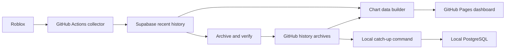

# Storage design and recovery

The cloud pipeline collects public Roblox observations while the PC is off. Supabase holds recent working history. Verified compressed archives preserve older observations and rebuild hosted charts independently of the local database.

## Retention and publication

- Raw Supabase observations: seven completed UTC days plus today.
- Hourly Supabase observations: fourteen completed UTC days plus today.
- Hosted chart window: approximately thirty days, rebuilt from recent database observations and verified archives.
- Long-term raw history: immutable compressed release assets and local verified copies.
- Forecast model: pinned version and digest, independent of storage maintenance.
- Forecast journals: legacy release plus dated UTC releases, preserving original issue/outcome timestamps.

An archive must pass SHA-256, size, header, row-count, identity and database-ledger checks before it can restore chart points. Observations are reduced to the latest actual capture per UTC hour; missing observations stay absent. New games are backfilled even when their archives were already processed for other games. Warm collection uses incremental database reads and verified checkpoint provenance.

Hourly cleanup freshly downloads and verifies every candidate archive and manifest. The server-only cleanup function requires those digests, protects recent and unarchived rows, and preserves hourly rows still backed by a live raw observation. Public and authenticated client roles cannot call it. A failed verification prevents cleanup. Setup SQL itself performs no deletion.

## Verified migration on October 28, 2026

The local import preserved **1,200,025 raw observations**, across **26 archived UTC days** and **1,167 game IDs**. A restart and repeat sync preserved the rows and added no duplicates. Original anomalous values, including negative favorites, were retained.

A cache-free rehearsal using only fourteen simulated database days produced the same **563,322 chart points across 1,000 currently tracked games**, with identical game/genre metrics, as the full-history reference. An actual cache-free cloud deployment also restored all 26 archive days, with the live Blox Fruits chart reaching October 2.

Before pruning, full-field daily fingerprints of **261,671 candidate hourly rows** matched their local reconstruction. A recovery CSV round-trip restored the original 1,549 rows from the first archived day into a temporary PostgreSQL table. The cloud maintenance worker then removed exactly 261,671 hourly rows after freshly verifying all twelve source archives.

| Measurement | Before maintenance | After maintenance |
| --- | ---: | ---: |
| Database size, decimal MB | 366.0 | 270.7 |
| Hourly index size, decimal MB | 138.7 | 43.4 |
| Hourly rows after pruning | 354,994 | 354,994 |
| Index validity | All valid | All valid |

The size reduction came from concurrently rebuilding the existing indexes after verified pruning. Ordinary vacuum made deleted-row space reusable and refreshed statistics. No full-table rewrite or index removal was necessary. These are point-in-time measurements; subsequent observations and maintenance change usage.

## Operations

1. Open Docker Desktop, then run `npm run history:sync` or double-click `scripts/syncLocalHistory.cmd` to catch up locally.
2. Run `npm run history:status` to inspect coverage, or `npm run history:sql` to query observations.
3. Run `npm run history:recover -- YYYY-MM-DD` to export a deleted hourly day as a recovery CSV. See [Local history](LOCALHISTORY.md) for restore steps.
4. Use the collection workflow's `rebuildHistory` input to exercise a real cache-free chart rebuild. The PC is not involved.
5. Run `database/inspectStorage.sql` for a read-only capacity audit. The one-time concurrent index and ordinary-vacuum commands are separate files in `database/`; they are not run on every collection.

Keep the release archives and local source copies. The collector cache and generated Pages JSON are replaceable outputs. Failed collections, archive failures, exhausted quotas and scheduler-token expiry still need operational attention. The README records existing replay budgets and scheduler setup.

## Validation

The data suite includes archive corruption, missing manifests, conflicting versions, cache-free/monthly equivalence, new-game recovery, pruning permissions and retention guards, SQL rollback, and chronological replay across legacy and dated forecast releases. Run `npm run test:data`. `npm run history:rehearse` performs the larger local archive comparison after history sync.
